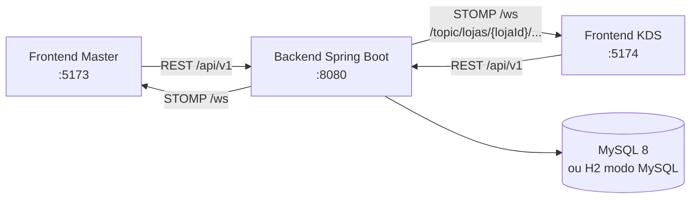

# ☕ OrderFlow — Ecossistema Comercial para Cafeterias

Plataforma completa de operação para cafeterias: **PDV de balcão**, **retaguarda administrativa**, **caixa com fechamento cego e conferência gerencial** e **KDS (Kitchen Display System) em tempo real**.

O monorepo reúne três aplicações que se comunicam via **REST** e **WebSocket STOMP**:

```text
ECOSSISTEMA_ORDERFLOW/
├── contratos/          # Fonte da verdade: arquitetura, OpenAPI 3.1 e catálogo de erros RFC 7807
├── backend/            # API Spring Boot — Monólito Modular (porta 8080)
├── frontend-master/    # Retaguarda, Catálogo, Caixa e PDV — React + Vite (porta 5173)
├── frontend-kds/       # Painel de produção da cozinha — React + Vite (porta 5174)
├── start-all.bat       # Orquestrador Windows (CMD)
└── start-all.ps1       # Orquestrador PowerShell
```

---

## Arquitetura



### `backend/` — API Spring Boot (Monólito Modular)
| Módulo | Responsabilidade |
| :--- | :--- |
| `auth` | Login JWT (access + refresh), RBAC (`ATENDENTE`, `COZINHA`, `GERENTE`, `ADMIN`), validação de PIN de alçada |
| `catalogo` | Categorias (2 níveis), produtos, combos, modificadores, insumos, histórico de preços e controle de ruptura (86) |
| `caixa` | Sessões de caixa, sangria/suprimento com alçada, fechamento cego e conferência gerencial |
| `pedido` | Máquina de estados do pedido, pagamentos, outbox monotônica (`seq`) e endpoints da cozinha |
| `shared` | UUIDv7 em `BINARY(16)`, segurança, erros RFC 7807, STOMP com heartbeat `10000,10000`, seed local |

**Stack:** Spring Boot 3.3 · Spring Data JPA · Flyway · Spring Security + JWT (Nimbus) · WebSocket STOMP nativo · springdoc-openapi.

### `frontend-master/` — Retaguarda & PDV
React 18 + Vite + TypeScript + Tailwind. Login com RBAC, modal global de PIN gerencial, gestão de catálogo, controle 86 de insumos, operação de caixa (abertura, sangria, fechamento cego, conferência), PDV e monitor de pedidos.

### `frontend-kds/` — Kitchen Display System
React 18 + Vite + TypeScript + Tailwind, em modo escuro e otimizado para toque. Filtro por estação (Bar/Cozinha), SLA visual (`< 5 min` verde · `5–10 min` âmbar · `> 10 min` vermelho pulsante), alertas sonoros via Web Audio API, replay monotônico (`desdeSeq`) e transições com controle otimista de versão. **Não exibe nenhum dado financeiro.**

---

## Requisitos

| Ferramenta | Versão | Observação |
| :--- | :--- | :--- |
| **Java (JDK)** | 21+ recomendado | O projeto compila com `release 17`, portanto JDK 17 também funciona |
| **Node.js** | 18+ | Testado com Node 24 / npm 11 |
| **MySQL** | 8.x | **Opcional** — sem MySQL, o perfil `local` usa H2 em modo de compatibilidade MySQL |
| **Maven** | — | Não é necessário instalar: use o wrapper `mvnw` incluído |

## Portas

| Serviço | URL |
| :--- | :--- |
| Backend API | http://localhost:8080 |
| Swagger UI | http://localhost:8080/swagger-ui.html |
| Health check | http://localhost:8080/actuator/health |
| Frontend Master | http://localhost:5173 |
| Frontend KDS | http://localhost:5174 |

---

## Rodando localmente após o `git clone`

### 1. Clonar e instalar as dependências dos frontends
```bash
git clone https://github.com/izaac-Martins/OrderFlow-Web.git
cd OrderFlow-Web

cd frontend-master && npm install && cd ..
cd frontend-kds && npm install && cd ..
```
> No Windows PowerShell, caso `npm` seja bloqueado pela ExecutionPolicy, use `npm.cmd install`.

### 2. Escolher o banco de dados

**Opção A — Sem instalar nada (padrão, perfil `local`):** o backend cria um banco H2 em modo MySQL em `backend/target/orderflow_local_db`. Nenhuma configuração é necessária.

**Opção B — MySQL 8 (perfil `mysql`):** as migrations Flyway (`V1__schema_inicial.sql` e seguintes) são aplicadas automaticamente na inicialização.
```bash
# Linux/macOS
export SPRING_PROFILES_ACTIVE=mysql
export ORDERFLOW_DB_URL="jdbc:mysql://localhost:3306/orderflow?createDatabaseIfNotExist=true&serverTimezone=UTC"
export ORDERFLOW_DB_USER=root
export ORDERFLOW_DB_PASSWORD=sua_senha
```
```powershell
# Windows PowerShell
$env:SPRING_PROFILES_ACTIVE="mysql"
$env:ORDERFLOW_DB_URL="jdbc:mysql://localhost:3306/orderflow?createDatabaseIfNotExist=true&serverTimezone=UTC"
$env:ORDERFLOW_DB_USER="root"
$env:ORDERFLOW_DB_PASSWORD="sua_senha"
```

### 3. Subir o ecossistema

**Windows (tudo de uma vez):**
```cmd
start-all.bat
```

**Manualmente (qualquer SO), em três terminais:**
```bash
# Terminal 1 — Backend
cd backend && ./mvnw spring-boot:run        # Windows: mvnw.cmd spring-boot:run

# Terminal 2 — Frontend Master
cd frontend-master && npm run dev           # http://localhost:5173

# Terminal 3 — Frontend KDS
cd frontend-kds && npm run dev              # http://localhost:5174
```

Na primeira inicialização, o seed cria automaticamente a Loja Matriz, os usuários abaixo e dois terminais de caixa.

### 4. Rodar os testes do backend
```bash
cd backend && ./mvnw test
```

---

## 🔑 Credenciais padrão de teste

> ⚠️ **Apenas para desenvolvimento local.** Troque todas as senhas, PINs e o `ORDERFLOW_JWT_SECRET` antes de qualquer implantação.

| Perfil | E-mail | Senha | PIN de alçada |
| :--- | :--- | :--- | :--- |
| **Gerente** | `gerente@orderflow.local` | `123456` | `4829` |
| Admin | `admin@orderflow.local` | `123456` | `1234` |
| Operador de caixa | `caixa@orderflow.local` | `123456` | — |
| Atendente PDV | `atendente@orderflow.local` | `123456` | — |
| Cozinha / KDS | `cozinha@orderflow.local` | `123456` | — |

Loja Matriz: `019325f0-8a00-7000-8000-000000000001`

---

## Roteiro de validação ponta a ponta

1. Abra o **Master** (`:5173`) e o **KDS** (`:5174`) lado a lado.
2. No Master, entre como **Gerente** e abra uma sessão em **Operação de Caixa**.
3. No **PDV**, lance um pedido e clique em **Finalizar e Enviar p/ Cozinha (KDS)**.
4. No KDS, o pedido aparece com alerta sonoro e cronômetro de SLA → **Iniciar Preparo** → **Marcar Pronto**.
5. No **Monitor de Pedidos** do Master, o status muda para `PRONTO`.
6. Em **Operação de Caixa**, faça o **fechamento cego** e a **conferência gerencial** (PIN `4829`).

---

## ⚙️ Variáveis de ambiente do backend

| Variável | Padrão | Descrição |
| :--- | :--- | :--- |
| `SPRING_PROFILES_ACTIVE` | `local` | `local` (H2 modo MySQL) ou `mysql` |
| `ORDERFLOW_PORT` | `8080` | Porta HTTP |
| `ORDERFLOW_DB_URL` | `jdbc:mysql://localhost:3306/orderflow...` | URL JDBC (perfil `mysql`) |
| `ORDERFLOW_DB_USER` / `ORDERFLOW_DB_PASSWORD` | `root` / `root` | Credenciais do MySQL |
| `ORDERFLOW_JWT_SECRET` | segredo de desenvolvimento | **Obrigatório trocar em produção** (mín. 32 bytes) |
| `ORDERFLOW_JWT_ISSUER` | `https://cafeteria.local` | Emissor do JWT |

---

## ⚠️ Limitações conhecidas (modo de desenvolvimento)

Estes atalhos existem para facilitar a demonstração local e **devem ser removidos ou protegidos antes de produção**:

- **Ponte de sincronização sem autenticação:** os endpoints `/api/v1/bridge/**` (`EcosystemBridgeController`) e o console `/h2-console` estão liberados (`permitAll`) e guardam estado em memória.
- **Fallback de autenticação STOMP:** um `CONNECT` sem token (ou com token simulado `sim-jwt-*`) é aceito como um usuário local com perfil `GERENTE` (`StompAuthChannelInterceptor`).
- **Modo de simulação nos frontends:** quando o backend está indisponível, os frontends usam dados locais (`localStorage`) para continuar operando.

---

## Contratos

- [`contratos/planejamento_arquitetural_cafeteria.md`](contratos/planejamento_arquitetural_cafeteria.md) — decisões arquiteturais e modelo de domínio
- [`contratos/openapi.yaml`](contratos/openapi.yaml) — contrato OpenAPI 3.1 da API
- [`contratos/catalogo_erros.md`](contratos/catalogo_erros.md) — catálogo de erros RFC 7807 e regras de segurança STOMP
