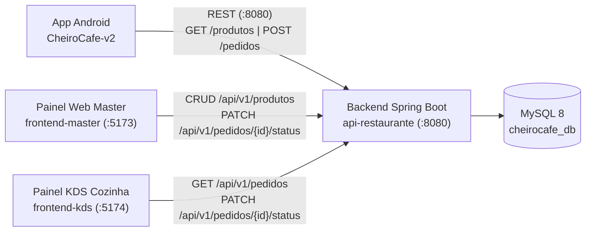

# ☕ OrderFlow & Cheiro de Café — Ecossistema Full-Stack Integrado

Monorepo oficial do ecossistema **OrderFlow & Cheiro de Café**, reunindo em uma arquitetura unificada:
1. **Backend Spring Boot (`api-restaurante`)**: API RESTful conectada ao MySQL (`cheirocafe_db`), com precisão financeira rigorosa (`BigDecimal` `scale=2`, `RoundingMode.HALF_UP`), bloqueio otimista (`@Version`) e máquina de estados canônica de pedidos.
2. **Painel Web Master (`frontend-master`)**: Retaguarda administrativa e PDV em React 18 + TypeScript + Vite (porta `5173`), responsável pela governança exclusiva do catálogo (produtos, categorias, subcategorias condicionais, variantes e adicionais globais/específicos) e pelo monitoramento gerencial de comandas.
3. **Painel KDS da Cozinha (`frontend-kds`)**: Kitchen Display System em tempo real (porta `5174`) com fila de produção por estação (Bar/Barista e Cozinha/Forno), cronômetro de SLA e transições de preparo.
4. **Aplicativo Mobile Android (`CheiroCafe-v2`)**: Terminal móvel de atendimento e vendas em Kotlin + MVVM + Room (*Offline-First*) + Retrofit + `ListAdapter`/`DiffUtil`, operando em grade simétrica de 2 colunas com monitor de pedidos em tempo real.

---

## 📂 Estrutura do Repositório

```text
OrderFlow-Web/
├── api-restaurante/    # Backend Spring Boot + JPA/Hibernate + MySQL (porta 8080)
├── frontend-master/    # Sistema Web Master: Catálogo, PDV, Caixa e Monitor (porta 5173)
├── frontend-kds/       # Painel KDS de Cozinha e Barista em Tempo Real (porta 5174)
├── CheiroCafe-v2/      # App Android Nativo (Kotlin, MVVM, Room Offline-First, Retrofit)
├── contratos/          # Especificações de arquitetura, OpenAPI e catálogo de erros
├── start-all.bat       # Inicializador automático para Windows (CMD)
└── start-all.ps1       # Inicializador automático para Windows (PowerShell)
```

---

## 🏗️ Arquitetura e Fluxo Operacional



### Máquina de Estados Canônica do Pedido
Todos os módulos (Backend, Web Master, KDS e App Android) operam sincronizados sobre os **5 estados canônicos**:
- `RECEBIDO` ➔ Pedido registrado pela mesa/balcão e aguardando início na fila da cozinha.
- `EM_PREPARO` ➔ Produção iniciada pelo barista ou cozinha.
- `PRONTO` ➔ Pedido finalizado na bancada, aguardando entrega ao cliente/garçom.
- `ENTREGUE` ➔ Estado terminal de conclusão na mesa/balcão.
- `CANCELADO` ➔ Estado terminal de cancelamento operacional.

### Diretrizes de Engenharia Aplicadas
- **Precisão Financeira (`BigDecimal`):** Todas as operações monetárias utilizam `BigDecimal` com escala `2` e arredondamento `RoundingMode.HALF_UP` ponta a ponta (MySQL `DECIMAL(10,2)` ➔ Spring Boot ➔ React/TypeScript ➔ Kotlin/Room).
- **Prevenção de N+1 Queries e Concorrência:** Entidades JPA otimizadas com `@Fetch(FetchMode.SUBSELECT)` e `@BatchSize(size = 50)`, além de controle de concorrência otimista com `@Version` na entidade `Pedido` (retornando `HTTP 409 Conflict` em disputas simultâneas).
- **Resiliência Offline-First no Android:** O cardápio é persistido no banco local SQLite (`Room`) como *Single Source of Truth*. Caso o Wi-Fi oscile no salão, o app continua exibindo o cardápio em cache e enfileira novos pedidos localmente (`PENDENTE_SYNC`), sincronizando-os automaticamente assim que a conexão retorna.

---

## 🛠️ Pré-Requisitos

Certifique-se de ter instalado na máquina de desenvolvimento/homologação:

| Ferramenta | Versão Mínima | Finalidade |
| :--- | :--- | :--- |
| **Java JDK** | **17+** (17 ou 21) | Compilação e execução do backend Spring Boot (`api-restaurante`) |
| **Node.js & npm** | **18+** (recomendado 20/22 LTS) | Execução do Painel Web Master (`:5173`) e KDS (`:5174`) |
| **MySQL Server** | **8.0+** | Banco de dados relacional (`cheirocafe_db` na porta `3306`) |
| **Android Studio** | **Ladybug / Iguana+** (SDK 34+) | Compilação e instalação do app Android (`CheiroCafe-v2`) |

---

## 🚀 Passo a Passo: Como Rodar o Ecossistema Após o `git clone`

### Passo 0 — Clonar o Repositório
```bash
git clone https://github.com/izaac-Martins/OrderFlow-Web.git
cd OrderFlow-Web
```

---

### Passo 1 — Configurar e Iniciar o Backend (`api-restaurante` na Porta `8080`)

1. Certifique-se de que o serviço do **MySQL** está ativo na porta `3306`.
2. Verifique as variáveis de conexão em `api-restaurante/src/main/resources/application.properties` (ou defina variáveis de ambiente):
   ```properties
   server.port=8080
   server.address=0.0.0.0
   spring.datasource.url=${DB_URL:jdbc:mysql://localhost:3306/cheirocafe_db?createDatabaseIfNotExist=true&useSSL=false&allowPublicKeyRetrieval=true&serverTimezone=America/Sao_Paulo}
   spring.datasource.username=${DB_USERNAME:root}
   spring.datasource.password=${DB_PASSWORD:0311}
   spring.jpa.hibernate.ddl-auto=update
   ```
   > O parâmetro `createDatabaseIfNotExist=true` cria automaticamente o schema `cheirocafe_db` caso ainda não exista, e o Hibernate cria/atualiza as tabelas na inicialização.

3. Inicie o servidor Spring Boot:
   ```bash
   cd api-restaurante
   # No Windows (CMD / PowerShell):
   .\mvnw.cmd spring-boot:run

   # No Linux / macOS:
   ./mvnw spring-boot:run
   ```
4. Teste se os endpoints estão respondendo:
   - Catálogo: `http://localhost:8080/api/v1/produtos`
   - Pedidos: `http://localhost:8080/api/v1/pedidos`

---

### Passo 2 — Instalar e Iniciar o Painel Web Master (`:5173`) e o KDS (`:5174`)

Em novos terminais na raiz do projeto, instale as dependências e inicie os servidores Vite:

#### Terminal A — Painel Web Master (Catálogo, PDV e Monitor Gerencial)
```bash
cd frontend-master
npm install
npm run dev -- --host 0.0.0.0 --port 5173
```
- Acesse em: **`http://localhost:5173`**

#### Terminal B — Painel KDS (Cozinha e Barista)
```bash
cd frontend-kds
npm install
npm run dev -- --host 0.0.0.0 --port 5174
```
- Acesse em: **`http://localhost:5174`**

> 💡 **Atalho no Windows:** Você também pode executar `start-all.bat` ou `.\start-all.ps1` na raiz do repositório para abrir automaticamente os 3 terminais (`api-restaurante`, `frontend-master` e `frontend-kds`).

---

### Passo 3 — Configurar o IP Local e Executar o App Android (`CheiroCafe-v2`)

Para que o celular físico (ou emulador) se comunique com o backend Spring Boot via rede Wi-Fi local:

1. Descubra o endereço **IPv4 local** do seu computador na rede Wi-Fi/Ethernet:
   - No Windows (`ipconfig` ou PowerShell):
     ```powershell
     ipconfig
     # Exemplo de saída: Endereço IPv4 . . . . . : 192.168.100.36
     ```
2. Abra a pasta `CheiroCafe-v2` no **Android Studio**.
3. Edite o arquivo:
   `CheiroCafe-v2/app/src/main/java/com/example/cheirocafe/RetrofitClient.kt`
4. Atualize a constante `BASE_URL` com o IPv4 da sua máquina mantendo a porta `8080` e a barra `/` ao final:
   ```kotlin
   object RetrofitClient {
       // Substitua pelo IPv4 local da máquina onde o api-restaurante está rodando
       // (Caso use o Emulador do Android Studio na mesma máquina, pode usar "http://10.0.2.2:8080/")
       private const val BASE_URL = "http://192.168.100.36:8080/"
   ```
5. Conecte o celular na **mesma rede Wi-Fi** do computador e clique em **Run ('app')** no Android Studio.

---

## 🔑 Credenciais Padrão de Acesso (Painel Web Master)

Ao abrir `http://localhost:5173`, você pode clicar diretamente nos botões de **Acesso Rápido por Perfil** no rodapé do card de login ou utilizar as credenciais abaixo:

| Perfil Operacional | E-mail Corporativo | Senha Padrão | PIN de Alçada Gerencial |
| :--- | :--- | :---: | :---: |
| **Gerente de Loja** *(Recomendado)* | `gerente@orderflow.local` | `123456` | `4321` ou `1234` |
| **Administrador Master** | `admin@orderflow.local` | `123456` | `4321` ou `1234` |
| **Operador de Caixa** | `caixa@orderflow.local` | `123456` | — |
| **Atendente / Balcão** | `atendente@orderflow.local` | `123456` | — |

---

## ✅ Roteiro de Homologação End-to-End

1. **Cadastro de Produto no Web Master (`http://localhost:5173/catalogo`):**
   - Faça login como **Gerente** e acesse **Catálogo de Produtos**.
   - Crie ou edite um item selecionando a categoria (`BEBIDAS`, `DOCES` ou `SALGADOS`), subcategoria condicional (para bebidas), variantes de tamanho e adicionais.
2. **Sincronização e Venda no App Android (`CheiroCafe-v2`):**
   - No celular, o cardápio exibe os produtos em grade simétrica de 2 colunas e armazena-os no banco local `Room`.
   - Selecione um produto, escolha variante/adicionais, atribua à mesa (conta única ou dividida por cliente) e toque em **Enviar para a Cozinha**.
3. **Preparo no KDS (`http://localhost:5174`) e Monitoramento (`http://localhost:5173/pedidos`):**
   - O pedido entra imediatamente como `RECEBIDO`.
   - Avance o status para **`EM_PREPARO`** ➔ **`PRONTO`** ➔ **`ENTREGUE`** pelo KDS ou pelo Monitor de Pedidos Web.
   - Acompanhe a barra de progresso e o badge de status atualizando em tempo real na tela **Monitor de Pedidos** do aplicativo Android.
