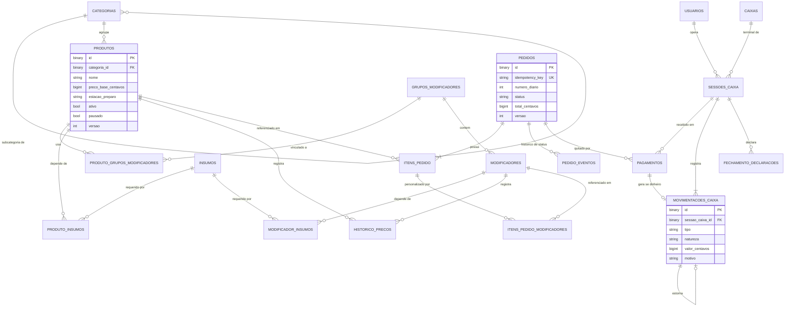
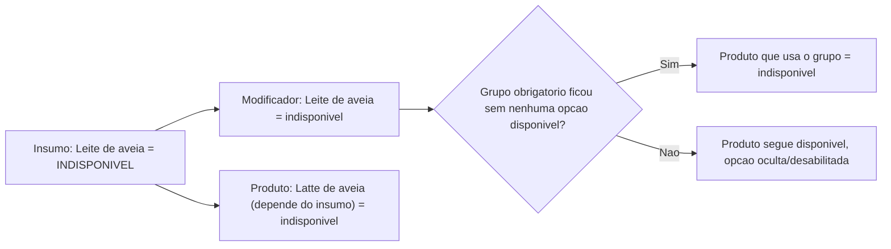
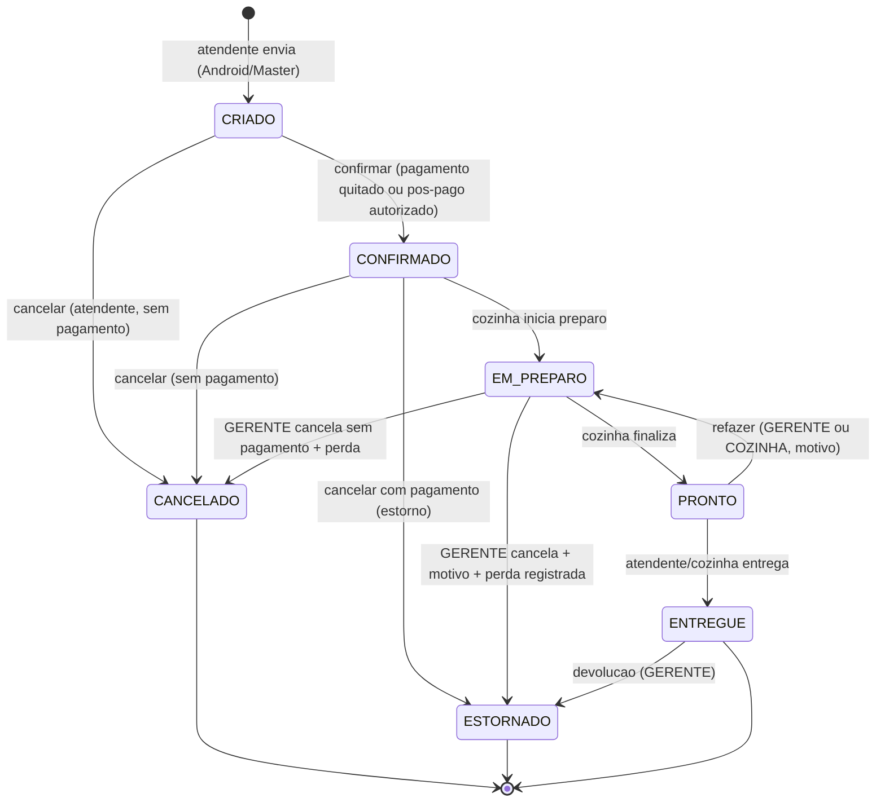
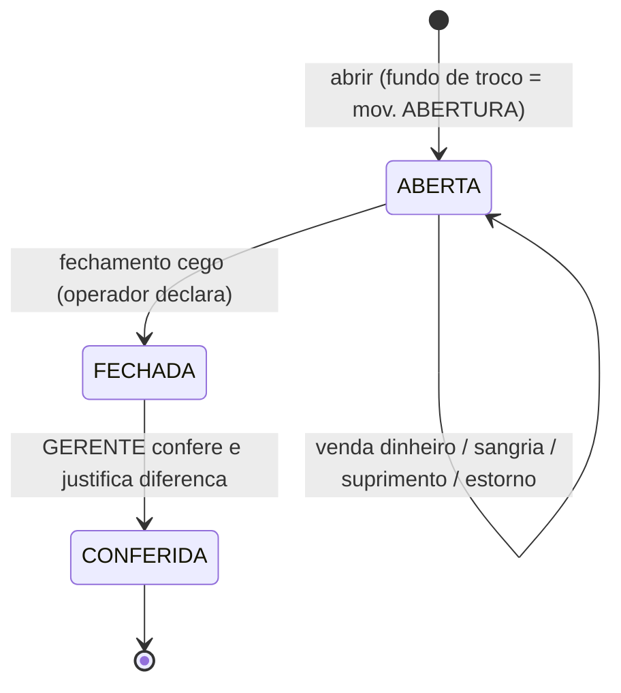
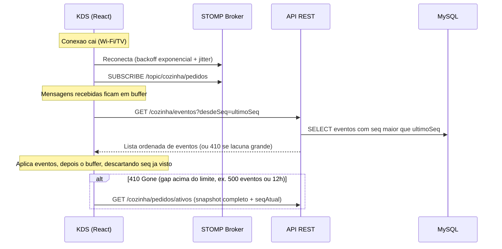
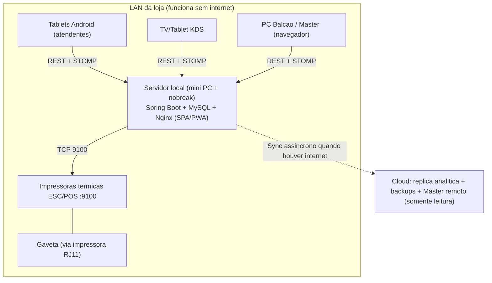
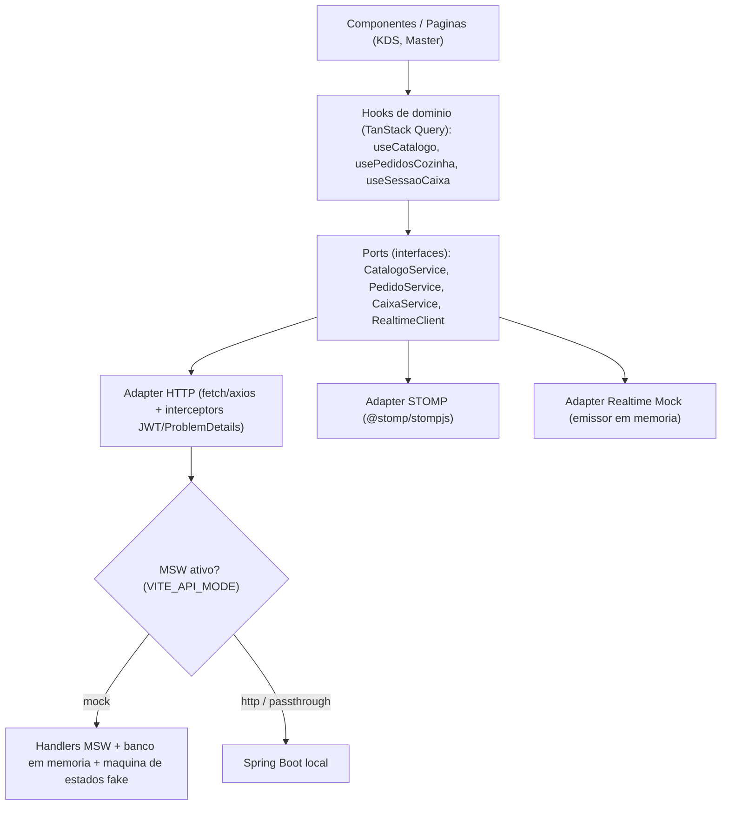

# Planejamento Arquitetural — Sistema Master & KDS (Cafeteria)

> [!IMPORTANT]
> Documento da **etapa de planejamento**. Não contém código-fonte de implementação. Os blocos JSON abaixo são **contratos de dados** (especificação), não implementação.

---

## 0. Decisões Transversais (premissas adotadas)

| Tema | Decisão | Justificativa |
|---|---|---|
| Identificadores | **UUIDv7** armazenado como `BINARY(16)` em todas as tabelas transacionais | Ordenável por tempo (bom para índice InnoDB), gerável no cliente (Android) para idempotência e **sem colisão na sincronização com a cloud** / multi-loja futura. |
| Valores monetários | **Inteiro em centavos** (`BIGINT`) no banco, no backend e no JSON | Elimina erros de ponto flutuante no JavaScript e no Kotlin; arredondamento explícito apenas no cálculo de percentuais (regra: *HALF_EVEN* no centavo). |
| Datas | `DATETIME(3)` em **UTC** no banco; conversão para `America/Sao_Paulo` só na apresentação e nas agregações de "horário de pico" | Evita distorções em horário de verão / relatórios. |
| Auditoria padrão | Toda tabela: `created_at`, `updated_at`, `created_by`, `updated_by` (FK → `usuarios`) via JPA Auditing | Exigência do briefing. Tabelas **imutáveis** (movimentações, eventos) só possuem `created_*`. |
| Exclusão | **Soft delete / arquivamento** (`arquivado_em`) para catálogo; **nunca** delete físico em dados financeiros | Pedidos antigos referenciam produtos; integridade histórica. |
| Concorrência | **Optimistic locking** (`versao INT`) em agregados mutáveis (pedido, produto, sessão de caixa) | Detectar corrida cozinha × atendente sem locks pesados. |
| Erros HTTP | **RFC 7807 Problem Details** com `code` de negócio estável | Front e Android tratam por `code`, não por texto. |
| Versionamento API | Prefixo `/api/v1` | Android em campo não atualiza na mesma hora que o servidor. |
| Multi-loja | **`loja_id` (FK → `lojas`) em todas as tabelas de negócio**; unicidades escopadas por loja (ex.: `UNIQUE(loja_id, sku)`); claim `lojaId` no JWT; filtro automático por tenant no repositório | Decisão aprovada: preparar multi-loja desde já. Cada loja tem seu servidor on-premise; a cloud consolida. |
| Fiscal | **Fora do escopo**; porta `EmissorFiscalPort` (adapter no-op) disparada no evento `PedidoQuitado`; coluna `fiscal_status` nullable em `pedidos` | Decisão aprovada: ponto de integração preparado sem acoplamento. |

---

## 1. Mapeamento de Entidades e Relacionamentos (DER Lógico)

### 1.1 Diagrama



### 1.2 Dicionário de entidades

Campos de auditoria padrão (`created_at`, `updated_at`, `created_by`, `updated_by`) estão implícitos em todas as tabelas, exceto quando marcadas como **imutáveis**.

#### Módulo Catálogo

| Tabela | Campos principais | Constraints / Regras |
|---|---|---|
| `categorias` | `id`, `parent_id` (FK self, nullable), `nome`, `slug`, `ordem`, `ativo`, `estacao_preparo_padrao` (`BAR`, `COZINHA`, `NENHUMA`), `arquivado_em` | `UNIQUE(parent_id, slug)`; profundidade máxima **2 níveis** (categoria → subcategoria) validada no serviço; não arquivar categoria com produtos ativos (409). |
| `produtos` | `id`, `categoria_id` (FK), `sku` , `nome`, `descricao`, `imagem_url`, `preco_base_centavos`, `estacao_preparo` (herda da categoria se nulo; ignorado em COMBO), `tipo` (`SIMPLES`, `COMBO`), `ativo`, `pausado`, `motivo_pausa`, `ordem`, `versao`, `arquivado_em` | `UNIQUE(loja_id, sku)`; `CHECK(preco_base_centavos >= 0)`; FK `RESTRICT`. |
| `grupos_modificadores` | `id`, `nome` (ex.: "Tipo de leite"), `nome_interno`, `min_selecao`, `max_selecao`, `permite_repeticao` (ex.: 3 doses extras), `ordem`, `ativo` | `CHECK(min_selecao >= 0 AND max_selecao >= min_selecao AND max_selecao >= 1)`. Grupo **obrigatório** ≡ `min_selecao >= 1`. |
| `modificadores` | `id`, `grupo_id` (FK), `nome`, `tipo_preco` (`FIXO`, `PERCENTUAL`, `NENHUM`), `valor_preco` (centavos se FIXO; **basis points** se PERCENTUAL, ex.: 1500 = 15%), `padrao` (pré-selecionado), `max_quantidade`, `ativo`, `pausado`, `ordem`, `versao` | `UNIQUE(grupo_id, nome)`; `CHECK(valor_preco >= -10000)` permite desconto percentual limitado (ex.: "sem chantilly −5%"). |
| `produto_grupos_modificadores` | `produto_id` (FK), `grupo_id` (FK), `ordem`, `min_selecao_override`, `max_selecao_override` | **PK composta** `(produto_id, grupo_id)`. Overrides permitem reutilizar o grupo "Calda" com limite diferente por produto. |
| `insumos` | `id`, `nome` (ex.: "Leite vegetal de aveia"), `unidade`, `disponivel`, `motivo_indisponibilidade`, `versao` | `UNIQUE(nome)`. Controle de estoque quantitativo **fora de escopo** nesta fase (apenas disponibilidade booleana). |
| `produto_insumos` | `produto_id`, `insumo_id` | PK composta. Dependência **obrigatória** do produto. |
| `modificador_insumos` | `modificador_id`, `insumo_id` | PK composta. Ex.: modificador "Leite de aveia" depende do insumo "Leite de aveia". |
| `historico_precos` (**imutável**) | `id`, `entidade_tipo` (`PRODUTO`, `MODIFICADOR`), `entidade_id`, `tipo_preco_anterior`, `valor_anterior`, `tipo_preco_novo`, `valor_novo`, `motivo`, `vigente_desde`, `created_at`, `created_by` | Insert-only; índice `(entidade_tipo, entidade_id, vigente_desde)`. FK polimórfica validada no serviço. |
| `combo_slots` | `id`, `combo_produto_id` (FK → `produtos` com `tipo = COMBO`), `nome` (ex.: "Bebida", "Acompanhamento"), `min_selecao`, `max_selecao`, `ordem` | `CHECK(0 <= min <= max, max >= 1)`; produto pai deve ser `COMBO` (validação de serviço). |
| `combo_slot_opcoes` | `slot_id` (FK), `produto_id` (FK → produto `SIMPLES`), `acrescimo_centavos` (ex.: trocar suco por smoothie +4,00), `padrao`, `ordem` | PK composta; `CHECK(acrescimo_centavos >= 0)`; combo não pode conter combo (sem aninhamento). |
| `catalogo_versao` | uma linha por loja: `loja_id`, `versao BIGINT`, `atualizado_em` | Incrementada na mesma transação de qualquer alteração de catálogo/disponibilidade (base do cache Android — ver §2.3). |

> [!NOTE]
> Para histórico **cadastral completo** (não só preço), recomendo **Hibernate Envers** nas entidades de catálogo (tabelas `*_aud` + `revinfo` com usuário). `historico_precos` permanece como tabela de negócio explícita, consultável pelo Master sem depender do Envers.

#### Módulo Pedidos

| Tabela | Campos principais | Constraints / Regras |
|---|---|---|
| `pedidos` | `id`, `idempotency_key`, `numero_diario` (senha exibida no KDS/painel), `data_operacional`, `origem` (`APP_ATENDENTE`, `MASTER_BALCAO`), `modalidade_pagamento` (`PRE_PAGO`, `POS_PAGO`), `mesa`, `fiscal_status` (nullable), `identificador_cliente` (nome/mesa), `observacao`, `status`, `subtotal_centavos`, `desconto_centavos`, `total_centavos`, `motivo_cancelamento`, `cancelado_por`, `versao`, `confirmado_em`, `preparo_iniciado_em`, `pronto_em`, `entregue_em` | `UNIQUE(idempotency_key)`; `UNIQUE(data_operacional, numero_diario)`; `CHECK(total = subtotal - desconto)` e `CHECK(total >= 0)`. Timestamps por etapa alimentam métricas de SLA da cozinha. |
| `itens_pedido` | `id`, `pedido_id` (FK `CASCADE` só na criação; nunca deletado após confirmado), `produto_id` (FK `RESTRICT`), `item_pai_id` (FK self, nullable — filho de combo), `combo_slot_id` (nullable), **snapshot**: `produto_nome`, `preco_base_centavos` (no filho de combo = `acrescimo_centavos`); `quantidade`, `preco_unitario_final_centavos` (base + modificadores), `total_centavos`, `estacao_preparo`, `observacao` | `CHECK(quantidade > 0)`. Snapshot garante que alteração de preço/nome não altere pedidos passados. |
| `itens_pedido_modificadores` | `id`, `item_pedido_id` (FK), `modificador_id` (FK `RESTRICT`), **snapshot**: `grupo_nome`, `modificador_nome`, `tipo_preco`, `valor_preco`; `quantidade`, `valor_calculado_centavos` | `UNIQUE(item_pedido_id, modificador_id)`. |
| `pedido_eventos` (**imutável**) | `seq BIGINT AUTO_INCREMENT` (global, monotônico), `id`, `pedido_id`, `status_anterior`, `status_novo`, `versao_pedido`, `motivo`, `payload_json` (snapshot para o KDS), `created_at`, `created_by` | Funciona como **trilha de auditoria + outbox** para o WebSocket e para a sincronização com a cloud (ver §3.3). |

#### Módulo Financeiro / Caixa

| Tabela | Campos principais | Constraints / Regras |
|---|---|---|
| `caixas` | `id`, `nome` (ex.: "Balcão 1"), `impressora_id`, `possui_gaveta`, `ativo` | Terminal físico. |
| `sessoes_caixa` | `id`, `caixa_id`, `operador_id`, `status` (`ABERTA`, `FECHADA`, `CONFERIDA`), `aberta_em`, `fechada_em`, `conferida_em`, `conferida_por`, **snapshot no fechamento**: `esperado_dinheiro_centavos`, `declarado_dinheiro_centavos`, `diferenca_dinheiro_centavos`; `observacao_conferencia`, `versao` | **Uma sessão aberta por caixa**: como o MySQL não tem índice único parcial, usar coluna gerada `caixa_aberto = IF(status='ABERTA', caixa_id, NULL)` com `UNIQUE`. Opcional: idem para `operador_id` (um operador, um caixa). Campos de snapshot só são preenchidos uma vez (transição ABERTA→FECHADA). |
| `pagamentos` | `id`, `pedido_id` (FK), `sessao_caixa_id` (FK), `idempotency_key`, `metodo` (`DINHEIRO`, `PIX`, `CREDITO`, `DEBITO`, `VOUCHER`), `valor_centavos` (valor que quita o pedido), `valor_recebido_centavos` e `troco_centavos` (só DINHEIRO), `status` (`CONFIRMADO`, `ESTORNADO`), `nsu` / `autorizacao` / `txid_pix`, `estornado_em`, `estornado_por`, `motivo_estorno` | `UNIQUE(idempotency_key)`; `CHECK(valor > 0)`; `CHECK(metodo <> 'DINHEIRO' OR valor_recebido = valor + troco)`. Pagamento **exige sessão ABERTA** (inclusive Pix/cartão, para fechar o caixa por meio de pagamento). |
| `movimentacoes_caixa` (**imutável**) | `id`, `sessao_caixa_id`, `tipo` (`ABERTURA`, `VENDA_DINHEIRO`, `SANGRIA`, `SUPRIMENTO`, `ESTORNO_VENDA_DINHEIRO`, `ESTORNO_MOVIMENTACAO`), `natureza` (`ENTRADA`, `SAIDA`), `valor_centavos`, `motivo`, `pagamento_id` (FK nullable, `UNIQUE`), `movimentacao_estornada_id` (FK self, nullable, `UNIQUE`), `aprovado_por` (nullable), `sinalizacao` (nullable: `SALDO_ESPERADO_NEGATIVO`, …) — preenchida no insert quando a sangria excede o saldo esperado, `created_at`, `created_by` | `CHECK(valor > 0)` — o sinal vem da `natureza`. `motivo NOT NULL` quando tipo ∈ {SANGRIA, SUPRIMENTO, ESTORNO_*}. Só pagamentos **DINHEIRO** geram linha (`VENDA_DINHEIRO` com valor **líquido** = recebido − troco). |
| `fechamento_declaracoes` (**imutável**) | `id`, `sessao_caixa_id`, `metodo`, `valor_declarado_centavos`, `valor_esperado_centavos`, `diferenca_centavos`, `quantidade_comprovantes` | `UNIQUE(sessao_caixa_id, metodo)`. Permite fechamento cego também de cartão/Pix (conferência com relatório da maquininha). |

#### Segurança

| Tabela | Campos | Regras |
|---|---|---|
| `usuarios` | `id`, `nome`, `login`, `senha_hash` (BCrypt/Argon2), `pin_hash` (troca rápida de operador no balcão), `role`, `ativo`, `ultimo_login_em` | `UNIQUE(login)`. |
| `refresh_tokens` | `id`, `usuario_id`, `token_hash`, `dispositivo`, `expira_em`, `revogado_em` | Revogação de sessão de tablet roubado/perdido. |
| `audit_log` (**imutável**) | `id`, `usuario_id`, `acao`, `recurso`, `recurso_id`, `ip`, `dispositivo`, `detalhes_json`, `created_at` | Ações sensíveis: login, sangria, cancelamento, estorno, alteração de preço, alteração de permissão. |

### 1.3 Imutabilidade do caixa — defesa em profundidade

1. **Domínio**: entidade sem setters / `@Immutable`; repositório expõe só `save` de novos registros e consultas.
2. **Banco**: triggers `BEFORE UPDATE` e `BEFORE DELETE` em `movimentacoes_caixa`, `pedido_eventos`, `historico_precos`, `fechamento_declaracoes` disparando erro.
3. **Privilégio**: o usuário MySQL da aplicação recebe apenas `SELECT, INSERT` nessas tabelas.
4. **Saldo nunca é coluna**: saldo esperado = `Σ ENTRADA − Σ SAIDA` da sessão (calculado). O único "saldo" persistido é o **snapshot de fechamento**, gravado uma única vez.
5. **Correção** = nova movimentação `ESTORNO_MOVIMENTACAO` referenciando a original (contabilidade por lançamento reverso).

---

## 2. Módulo de Produtos & Regras de Catálogo

### 2.1 Modificadores sem explosão combinatória de SKUs

- **Produto = SKU único** com preço base. Variações (tamanho, leite, doses, calda) **não** viram SKUs; são **grupos de modificadores reutilizáveis** ligados ao produto por **N:N** (`produto_grupos_modificadores`).
- Ex.: "Latte" + grupos {Tamanho (min 1/max 1), Leite (min 1/max 1), Dose extra (min 0/max 3, repetição), Calda (min 0/max 2)} → 1 SKU no lugar de dezenas.
- O grupo "Tipo de leite" é cadastrado **uma vez** e vinculado a todos os cafés com leite; alterar o preço do leite de aveia reflete em todos.
- `min/max_selecao_override` no vínculo resolve casos pontuais sem duplicar grupos.

**Regra de precificação (ordem determinística):**

1. `base` = `preco_base_centavos` do produto.
2. Soma dos modificadores **FIXO** × quantidade.
3. Modificadores **PERCENTUAL** aplicam-se sobre o **preço base** (não em cascata), arredondados no centavo — evita ambiguidade de ordem entre percentuais.
4. `preco_unitario_final = base + Σ fixos + Σ percentuais`; `total_item = preco_unitario_final × quantidade`.
5. Preço final nunca negativo (validação 422).

> [!IMPORTANT]
> **O servidor recalcula todo preço.** O Android envia apenas IDs e quantidades; qualquer valor monetário vindo do cliente é ignorado (ou usado só para detectar divergência e retornar `409 PRECO_DESATUALIZADO`, forçando refresh do catálogo).

**Validações na criação do item (servidor):**
- Todo grupo vinculado com `min ≥ 1` deve ter seleção.
- Σ quantidades por grupo ∈ [min, max]; quantidade por modificador ≤ `max_quantidade`; repetição só se `permite_repeticao`.
- Modificador deve pertencer a um grupo vinculado **àquele** produto.
- Produto e modificadores **disponíveis** no momento da gravação.

**Combos (decisão aprovada: incluídos no DER agora):**
- Combo = produto `tipo = COMBO` com preço próprio e **slots** (`combo_slots`), cada slot com opções de produtos simples (`combo_slot_opcoes`) e acréscimo opcional.
- Preço do combo = `preco_base` do combo + Σ `acrescimo_centavos` das opções escolhidas + Σ modificadores dos produtos escolhidos (regra de precificação acima aplicada sobre o **acréscimo**, não sobre o preço avulso do produto filho).
- No pedido: uma linha pai (combo) + linhas filhas (`item_pai_id`, `combo_slot_id`), cada filha com sua `estacao_preparo` — o KDS roteia os filhos por estação normalmente.
- Disponibilidade: combo disponível ⇔ cada slot com `min ≥ 1` tem ≥ `min` opções disponíveis.
- Sem combos aninhados.

### 2.2 Disponibilidade dinâmica (cálculo em cascata)



Regras:
- `modificador.disponivel = ativo ∧ ¬pausado ∧ todos insumos disponíveis`
- `produto.disponivel = ativo ∧ ¬pausado ∧ todos insumos disponíveis ∧ todo grupo obrigatório tem ≥ min opções disponíveis`
- Disponibilidade é **derivada** (calculada na projeção do catálogo), nunca gravada redundante — elimina inconsistência.
- A projeção calculada fica em cache em memória no servidor (invalidada a cada incremento de `catalogo_versao`).

### 2.3 Propagação instantânea para o Android (cache + invalidação)

Estratégia em 3 camadas, da mais rápida à mais robusta:

| Camada | Mecanismo | Papel |
|---|---|---|
| 1. Push | Tópicos STOMP `/topic/catalogo` e `/topic/disponibilidade` com payload leve `{ versao, tipo, ids[] }` | Atualização em < 1 s. Disponibilidade pode ser aplicada diretamente (payload contém o novo estado); mudanças estruturais disparam refetch. |
| 2. Pull condicional | `GET /api/v1/catalogo` com **ETag = catalogo_versao**; resposta `304 Not Modified` se nada mudou | Ao abrir o app, ao reconectar o WebSocket, ao voltar do background, e polling de segurança a cada 60 s. |
| 3. Validação autoritativa | Criação do pedido rejeita item indisponível com `422 ITEM_INDISPONIVEL` listando os IDs | Garante correção mesmo se o push falhar. O app mostra o item afetado no carrinho. |

No Android: Room como cache local do catálogo + `catalogoVersao` persistido; o carrinho revalida itens contra o cache a cada evento de disponibilidade (remove/sinaliza itens que ficaram indisponíveis antes do envio).

> [!NOTE]
> Sem internet não há FCM; por isso o push é via **STOMP na LAN** contra o servidor local — coerente com a premissa de resiliência.

---

## 3. Máquina de Estados e Concorrência

### 3.1 Ciclo de vida do Pedido



**Semântica dos terminais:**
- `CANCELADO`: pedido encerrado **sem** pagamento confirmado — nenhum efeito financeiro.
- `ESTORNADO`: pedido encerrado **com** pagamento(s) que foram revertidos. A transição é atômica: muda status + marca pagamentos como `ESTORNADO` + gera `ESTORNO_VENDA_DINHEIRO` (se dinheiro) na **sessão de caixa aberta atual** (não na original, que pode estar fechada).

**Matriz de autorização das transições:**

| Transição | ATENDENTE | COZINHA | GERENTE | ADMIN |
|---|:-:|:-:|:-:|:-:|
| criar / confirmar | ✅ | — | ✅ | ✅ |
| cancelar (CRIADO/CONFIRMADO) | ✅ | — | ✅ | ✅ |
| iniciar preparo / marcar pronto | — | ✅ | ✅ | ✅ |
| cancelar EM_PREPARO ou posterior | ❌ | ❌ | ✅ (motivo obrigatório) | ✅ |
| entregar | ✅ | ✅ | ✅ | ✅ |
| estornar / devolução | ❌ | ❌ | ✅ | ✅ |

**Independência do KDS em relação ao financeiro:** o KDS só enxerga pedidos `CONFIRMADO`, `EM_PREPARO`, `PRONTO` e o evento de cancelamento. O DTO da cozinha **não contém** valores monetários nem método de pagamento.

> [!NOTE]
> **Decisão aprovada — ambas as modalidades:**
> - `PRE_PAGO` (balcão): `confirmar` exige saldo devedor = 0; ao quitar 100% o servidor confirma automaticamente (configurável por loja).
> - `POS_PAGO` (mesa): `confirmar` não exige pagamento; o pedido pode chegar a `ENTREGUE` com `saldoDevedorCentavos > 0`. Pedidos entregues e não quitados aparecem em "Contas em aberto" no Master e geram alerta no fechamento de caixa.
> - `CANCELADO` vs `ESTORNADO` continua decidido pela existência de pagamento confirmado no momento do cancelamento.

### 3.2 Ciclo de vida da Sessão de Caixa



Regras:
- **Abertura** cria a sessão e, na mesma transação, a movimentação `ABERTURA` (fundo de troco, pode ser 0). Abre a gaveta via ESC/POS.
- **Sangria**: motivo obrigatório; acima de um limite configurável (ex.: 500,00) exige `aprovado_por` (PIN de gerente). Gera comprovante impresso em 2 vias.
- **Suprimento**: motivo obrigatório.
- **Pix/Cartão**: geram `pagamento` vinculado à sessão, **nenhuma** movimentação de caixa → não alteram saldo físico.
- **Fechamento cego**:
  1. Bloqueia novos pagamentos na sessão (transição atômica com checagem de `versao`).
  2. Operador informa contagem por método **sem** ver o esperado.
  3. Servidor calcula esperado (dinheiro = Σ movimentações; demais métodos = Σ pagamentos confirmados), grava `fechamento_declaracoes` + snapshot na sessão.
  4. Resposta ao operador: apenas protocolo e confirmação (sem diferença). Diferença visível só para `GERENTE+`.
  5. Pedidos ainda em aberto não bloqueiam o fechamento (pagamentos futuros cairão na próxima sessão), mas o sistema alerta.

> [!WARNING]
> **Vazamento do esperado durante o turno:** se o operador puder consultar o "saldo da gaveta" ou se a sangria retornar "saldo insuficiente (saldo atual X)", o fechamento cego perde sentido. Regras: endpoint de saldo restrito a `GERENTE+`; **decisão aprovada:** sangria acima do saldo esperado é **aceita** (201, resposta idêntica a uma sangria normal) e gravada com `sinalizacao = SALDO_ESPERADO_NEGATIVO`, gerando notificação em `/user/queue/notificacoes` dos gerentes e destaque na conferência.

### 3.3 Concorrência no pedido

**Cenário crítico:** atendente cancela enquanto a cozinha toca em "Iniciar preparo".

Mecanismo:
1. Toda transição recebe a `versao` que o cliente conhece.
2. A gravação é uma **atualização condicional**: só altera se `status` atual ∈ origens permitidas **e** `versao` = esperada; incrementa `versao`.
3. Quem commitar primeiro vence; o segundo recebe `409 Conflict` com `code = TRANSICAO_CONCORRENTE` e o **estado atual** no corpo, para a UI se ajustar ("Pedido já em preparo — solicite ao gerente").
4. Comandos são **idempotentes**: repetir "marcar pronto" num pedido já `PRONTO` retorna `200` com o estado atual (não 409), tratando double-tap e retry de rede.

Pagamentos também usam `Idempotency-Key` (UUID gerado no cliente) — retry após timeout nunca cobra duas vezes.

### 3.4 Entrega confiável no WebSocket da cozinha (reconexão sem perda)

Padrão **Transactional Outbox + número de sequência + snapshot**:

- Cada transição grava em `pedido_eventos` (com `seq` monotônico) **na mesma transação** do pedido.
- A publicação STOMP ocorre **após o commit** (listener de evento pós-transação); se o broker falhar, o evento continua no banco.
- Toda mensagem STOMP carrega `seq` e `versao` do pedido.
- O cliente KDS mantém `ultimoSeq` (memória + `localStorage`).



Complementos:
- **Heartbeat STOMP** 10 s/10 s para detectar conexão "zumbi" (comum em TVs).
- Indicador visual permanente de conexão no KDS (verde/amarelo/vermelho) e **alerta sonoro** em pedido novo.
- Regra de aplicação no cliente: ignora evento cujo `versao` ≤ `versao` já exibida para aquele pedido (idempotência de UI).
- Broker: **simple broker em memória** basta para um único nó on-premise; migração para relay (RabbitMQ STOMP) só se houver mais de uma instância.

---

## 4. Especificação dos Contratos de API

### 4.1 Convenções gerais

- Base: `/api/v1`; JSON `camelCase`; IDs UUID string; dinheiro em `...Centavos` inteiro.
- Autenticação: `Authorization: Bearer <JWT>` (access 15 min) + refresh token (12 h, rotativo). Claims: `sub`, `role`, `caixaId?`, `estacao?`.
- Paginação: `?page=0&size=20&sort=nome,asc` → `{ content[], page, size, totalElements }`.
- Concorrência: escrita em recurso versionado exige `versao` no corpo (ou `If-Match`).
- Idempotência: header `Idempotency-Key` obrigatório em `POST /pedidos`, `POST /pagamentos`, movimentações de caixa.

**Formato de erro (Problem Details):**

```json
{
  "type": "https://api.cafeteria.local/erros/transicao-concorrente",
  "title": "Transição de status não permitida",
  "status": 409,
  "code": "TRANSICAO_CONCORRENTE",
  "detail": "Pedido 0193... está EM_PREPARO; cancelamento exige GERENTE.",
  "traceId": "a1b2c3",
  "erros": [ { "campo": "versao", "mensagem": "esperado 4, atual 5" } ],
  "estadoAtual": { "status": "EM_PREPARO", "versao": 5 }
}
```

**Tabela de status HTTP:**

| Código | Uso |
|---|---|
| 200 | Leitura, comando idempotente repetido, atualização com corpo |
| 201 | Criação (com header `Location`) |
| 204 | Arquivamento / ação sem corpo |
| 304 | Catálogo inalterado (ETag) |
| 400 | JSON malformado / tipo inválido (Bean Validation) |
| 401 | Token ausente/expirado |
| 403 | Role sem permissão para a ação |
| 404 | Recurso inexistente |
| 409 | Conflito de estado/versão, caixa já aberto, unicidade, idempotency-key reutilizada com payload diferente |
| 410 | Gap de eventos grande demais (KDS deve buscar snapshot) |
| 422 | Regra de negócio violada (modificador fora do limite, item indisponível, sessão fechada, preço negativo) |
| 428 | Falta `versao`/`If-Match` ou `Idempotency-Key` |

### 4.2 Catálogo (Master — `GERENTE`, `ADMIN`; leitura também `ATENDENTE`)

| Método & Rota | Descrição | Sucesso | Erros típicos |
|---|---|---|---|
| `GET /categorias?arvore=true` | Árvore categoria → subcategorias | 200 | — |
| `POST /categorias` | Criar | 201 | 409 slug duplicado; 422 profundidade > 2 |
| `PUT /categorias/{id}` | Atualizar (com `versao`) | 200 | 409 versão |
| `PATCH /categorias/ordem` | Reordenar em lote `[{id, ordem}]` | 204 | 422 |
| `DELETE /categorias/{id}` | Arquivar | 204 | 409 possui produtos ativos |
| `GET /produtos?categoriaId=&q=&ativo=&disponivel=` | Listagem paginada | 200 | — |
| `GET /produtos/{id}` | Detalhe com grupos vinculados e insumos | 200 | 404 |
| `POST /produtos` | Criar | 201 | 409 SKU; 422 |
| `PUT /produtos/{id}` | Atualizar dados cadastrais (**não** altera preço) | 200 | 409 versão |
| `PATCH /produtos/{id}/preco` | Alterar preço + motivo → grava `historico_precos` | 200 | 422 |
| `PATCH /produtos/{id}/disponibilidade` | Pausar/ativar `{pausado, motivo}` | 200 | — |
| `PUT /produtos/{id}/grupos-modificadores` | Substitui vínculos (lista ordenada com overrides) | 200 | 422 override inválido |
| `PUT /produtos/{id}/insumos` | Substitui dependências de insumo | 200 | — |
| `GET /produtos/{id}/historico-precos` | Histórico | 200 | — |
| `DELETE /produtos/{id}` | Arquivar | 204 | — |
| `GET/POST /grupos-modificadores`, `PUT/DELETE /grupos-modificadores/{id}` | CRUD de grupo | 200/201/204 | 409 grupo em uso (arquivar) |
| `POST /grupos-modificadores/{id}/modificadores` | Criar modificador no grupo | 201 | 409 nome duplicado |
| `PUT /modificadores/{id}` · `PATCH /modificadores/{id}/preco` · `PATCH /modificadores/{id}/disponibilidade` | Atualizar / preço / pausar | 200 | 409, 422 |
| `GET/POST /insumos`, `PATCH /insumos/{id}/disponibilidade` | Insumos e esgotamento (`PATCH` também liberado para `COZINHA`) | 200/201 | — |
| `GET /catalogo` | **Projeção de leitura** para Android/balcão: categorias + produtos + grupos + disponibilidade calculada, `ETag` | 200 / 304 | — |

**DTO — `ProdutoRequest` (POST/PUT):**

```json
{
  "categoriaId": "0193a...",
  "sku": "LATTE",
  "nome": "Latte",
  "descricao": "Espresso com leite vaporizado",
  "imagemUrl": "https://.../latte.webp",
  "precoBaseCentavos": 1200,
  "estacaoPreparo": "BAR",
  "ativo": true,
  "ordem": 10,
  "versao": 3
}
```
Validação: `nome` 2–80; `sku` `^[A-Z0-9_-]{2,30}$`; `precoBaseCentavos` ≥ 0 (somente no POST; alteração via `/preco`); `categoriaId` existente e não arquivada; `versao` obrigatória no PUT.

**DTO — vínculo de grupos (`PUT /produtos/{id}/grupos-modificadores`):**

```json
{
  "versao": 4,
  "grupos": [
    { "grupoId": "g-tamanho", "ordem": 1 },
    { "grupoId": "g-leite", "ordem": 2 },
    { "grupoId": "g-calda", "ordem": 3, "minSelecaoOverride": 0, "maxSelecaoOverride": 1 }
  ]
}
```

**DTO — `GrupoModificadorRequest` com modificadores:**

```json
{
  "nome": "Tipo de leite",
  "minSelecao": 1,
  "maxSelecao": 1,
  "permiteRepeticao": false,
  "modificadores": [
    { "nome": "Integral", "tipoPreco": "NENHUM", "valorPreco": 0, "padrao": true },
    { "nome": "Aveia", "tipoPreco": "FIXO", "valorPreco": 300, "insumoIds": ["i-aveia"] },
    { "nome": "Tamanho G", "tipoPreco": "PERCENTUAL", "valorPreco": 2500 }
  ]
}
```
Validação: `0 ≤ min ≤ max`, `max ≥ 1`; no máximo um `padrao` se `max = 1`; `valorPreco` em centavos (FIXO) ou basis points (PERCENTUAL).

**DTO — `PATCH .../preco`:** `{ "tipoPreco": "FIXO", "valorPreco": 350, "motivo": "Reajuste fornecedor", "versao": 2 }` — `motivo` obrigatório (5–200).

**DTO — `CatalogoResponse` (resumo):**

```json
{
  "versao": 1842,
  "geradoEm": "2026-11-13T11:50:00Z",
  "categorias": [
    {
      "id": "c-cafes", "nome": "Cafés", "subcategorias": [
        {
          "id": "c-leite", "nome": "Com leite",
          "produtos": [
            {
              "id": "p-latte", "nome": "Latte", "precoBaseCentavos": 1200,
              "disponivel": true, "motivoIndisponibilidade": null,
              "grupos": [
                {
                  "id": "g-leite", "nome": "Tipo de leite", "minSelecao": 1, "maxSelecao": 1,
                  "modificadores": [
                    { "id": "m-aveia", "nome": "Aveia", "tipoPreco": "FIXO", "valorPreco": 300, "disponivel": false }
                  ]
                }
              ]
            }
          ]
        }
      ]
    }
  ]
}
```

### 4.3 Pedidos (Android/Balcão)

| Método & Rota | Role | Descrição | Sucesso | Erros |
|---|---|---|---|---|
| `POST /pedidos` | ATENDENTE+ | Cria pedido (`Idempotency-Key`) | 201 (ou 200 se mesma key/mesmo payload) | 409 key com payload diferente; 422 `ITEM_INDISPONIVEL`, `MODIFICADOR_LIMITE`, `MODIFICADOR_OBRIGATORIO` |
| `GET /pedidos/{id}` | ATENDENTE+ | Detalhe | 200 | 404 |
| `GET /pedidos?status=&data=&page=` | ATENDENTE+ | Listagem | 200 | — |
| `POST /pedidos/{id}/confirmar` | ATENDENTE+ | `{versao}` | 200 | 409, 422 sem pagamento (pré-pago) |
| `POST /pedidos/{id}/cancelar` | ATENDENTE (até CONFIRMADO) / GERENTE | `{versao, motivo, registrarPerda}` | 200 | 403 se EM_PREPARO e não gerente; 409 |
| `POST /pedidos/{id}/entregar` | ATENDENTE, COZINHA | `{versao}` | 200 | 409 |

**DTO — `CriarPedidoRequest`:**

```json
{
  "origem": "APP_ATENDENTE",
  "identificadorCliente": "Mesa 4 / Ana",
  "observacao": "Para viagem",
  "catalogoVersao": 1842,
  "itens": [
    {
      "produtoId": "p-latte",
      "quantidade": 2,
      "observacao": "Bem quente",
      "modificadores": [
        { "modificadorId": "m-tamanho-g", "quantidade": 1 },
        { "modificadorId": "m-aveia", "quantidade": 1 },
        { "modificadorId": "m-dose-extra", "quantidade": 2 }
      ]
    }
  ]
}
```

**DTO — `PedidoResponse`:** `id`, `numeroDiario`, `status`, `versao`, `itens[]` (com snapshots e valores calculados), `subtotalCentavos`, `descontoCentavos`, `totalCentavos`, `totalPagoCentavos`, `saldoDevedorCentavos`, timestamps de etapa.

### 4.4 Pagamentos

| Método & Rota | Role | Descrição | Sucesso | Erros |
|---|---|---|---|---|
| `POST /pagamentos` | ATENDENTE+ | Registra pagamento (`Idempotency-Key`) | 201 | 422 `SESSAO_CAIXA_FECHADA`, `VALOR_EXCEDE_SALDO`, `RECEBIDO_INSUFICIENTE` |
| `POST /pagamentos/{id}/estorno` | GERENTE+ | `{motivo}` | 200 | 409 já estornado; 422 sem sessão aberta para devolver dinheiro |

```json
{
  "pedidoId": "0193...",
  "sessaoCaixaId": "s-01",
  "metodo": "DINHEIRO",
  "valorCentavos": 3400,
  "valorRecebidoCentavos": 5000,
  "nsu": null
}
```
Resposta inclui `trocoCentavos` calculado pelo servidor. Pagamento múltiplo (dividir conta) = vários `POST`. Ao quitar 100% no fluxo pré-pago, o servidor pode confirmar o pedido automaticamente (configurável).

### 4.5 Caixa

| Método & Rota | Role | Descrição | Sucesso | Erros |
|---|---|---|---|---|
| `GET /caixas` | ATENDENTE+ | Terminais | 200 | — |
| `GET /caixa/sessoes/atual?caixaId=` | ATENDENTE+ | Sessão aberta (sem saldo esperado) | 200 / 404 | — |
| `POST /caixa/sessoes` | ATENDENTE+ | Abrir `{caixaId, fundoTrocoCentavos}` | 201 | 409 `CAIXA_JA_ABERTO`, `OPERADOR_COM_SESSAO` |
| `POST /caixa/sessoes/{id}/sangrias` | ATENDENTE+ | `{valorCentavos, motivo, pinAprovador?}` | 201 | 422 sessão não aberta; 403 `APROVACAO_NECESSARIA` |
| `POST /caixa/sessoes/{id}/suprimentos` | ATENDENTE+ | `{valorCentavos, motivo}` | 201 | 422 |
| `POST /caixa/sessoes/{id}/fechamento` | operador da sessão ou GERENTE | Fechamento cego `{versao, declaracoes[]}` | 200 `{protocolo, fechadaEm}` | 409 já fechada / versão |
| `GET /caixa/sessoes/{id}/conferencia` | GERENTE+ | Esperado × declarado × diferença por método | 200 | 403 |
| `POST /caixa/sessoes/{id}/conferir` | GERENTE+ | `{observacao}` → CONFERIDA | 200 | 409 |
| `GET /caixa/sessoes/{id}/movimentacoes` | GERENTE+ | Extrato | 200 | — |
| `POST /caixa/movimentacoes/{id}/estorno` | GERENTE+ | Lançamento reverso `{motivo}` | 201 | 409 já estornada |
| `GET /caixa/sessoes?de=&ate=&operadorId=&comDiferenca=true` | GERENTE+ | Histórico de sessões | 200 | — |

**DTO — Fechamento cego:**

```json
{
  "versao": 7,
  "declaracoes": [
    { "metodo": "DINHEIRO", "valorDeclaradoCentavos": 48350 },
    { "metodo": "CREDITO", "valorDeclaradoCentavos": 120000, "quantidadeComprovantes": 31 },
    { "metodo": "PIX", "valorDeclaradoCentavos": 95500 }
  ],
  "observacao": "Uma nota de 50 rasgada separada"
}
```
Validação: `DINHEIRO` obrigatório; valores ≥ 0; sem métodos duplicados.

**DTO — `ConferenciaResponse` (GERENTE):** por método `{ metodo, esperadoCentavos, declaradoCentavos, diferencaCentavos, situacao: "OK" | "QUEBRA" | "SOBRA" }` + composição do esperado em dinheiro (abertura, vendas, suprimentos, sangrias, estornos).

### 4.6 Cozinha (KDS — `COZINHA`, `GERENTE`, `ADMIN`)

| Método & Rota | Descrição | Sucesso | Erros |
|---|---|---|---|
| `GET /cozinha/pedidos/ativos?estacao=BAR` | Snapshot: CONFIRMADO, EM_PREPARO, PRONTO + `seqAtual` | 200 | — |
| `GET /cozinha/eventos?desdeSeq=&estacao=` | Replay de eventos | 200 / 410 | — |
| `POST /cozinha/pedidos/{id}/iniciar-preparo` | `{versao}` | 200 | 409 |
| `POST /cozinha/pedidos/{id}/marcar-pronto` | `{versao}` → notifica atendentes | 200 | 409 |
| `POST /cozinha/pedidos/{id}/refazer` | `{versao, motivo}` PRONTO → EM_PREPARO | 200 | 409 |
| `POST /cozinha/pedidos/{id}/entregar` | `{versao}` | 200 | 409 |
| `POST /cozinha/pedidos/{id}/reimprimir` | Reimpressão da comanda | 202 | — |

**Tópicos STOMP:**

| Destino | Assinantes | Conteúdo |
|---|---|---|
| `/topic/cozinha/pedidos` e `/topic/cozinha/{estacao}` | KDS | `PedidoCozinhaEvento` |
| `/topic/pedidos/prontos` | Android, painel de chamada | `{pedidoId, numeroDiario, identificadorCliente}` |
| `/topic/catalogo` · `/topic/disponibilidade` | Android, Master | `{versao, tipo, ids[], estado?}` |
| `/user/queue/notificacoes` | usuário específico | aprovações, alertas de caixa |

Autenticação STOMP: JWT validado no frame `CONNECT`; autorização por destino (ex.: `/topic/cozinha/**` exige `COZINHA+`).

**DTO — `PedidoCozinhaEvento`** (sem dados financeiros):

```json
{
  "seq": 98213,
  "tipo": "PEDIDO_CONFIRMADO",
  "pedidoId": "0193...",
  "versao": 2,
  "numeroDiario": 57,
  "identificadorCliente": "Ana",
  "status": "CONFIRMADO",
  "confirmadoEm": "2026-11-13T11:52:10Z",
  "observacao": "Para viagem",
  "itens": [
    {
      "itemId": "it-1", "produtoNome": "Latte", "quantidade": 2, "estacao": "BAR",
      "modificadores": ["G", "Leite de aveia", "2x Dose extra"],
      "observacao": "Bem quente"
    }
  ]
}
```

### 4.7 Dashboard (GERENTE, ADMIN)

| Rota | Parâmetros | Retorno |
|---|---|---|
| `GET /relatorios/faturamento` | `de`, `ate`, `granularidade=HORA\|DIA\|SEMANA\|MES` | série `{periodo, faturamentoCentavos, pedidos}` |
| `GET /relatorios/ticket-medio` | `de`, `ate`, `comparar=PERIODO_ANTERIOR` | `{ticketMedioCentavos, variacaoPercentual}` |
| `GET /relatorios/horarios-pico` | `de`, `ate` | matriz dia-da-semana × hora |
| `GET /relatorios/curva-abc` | `de`, `ate`, `criterio=FATURAMENTO\|QUANTIDADE` | `{produtoId, nome, valor, percentualAcumulado, classe}` |
| `GET /relatorios/tempo-preparo` | `de`, `ate`, `estacao` | p50/p90 de confirmação → pronto |

Base de cálculo: somente pedidos `ENTREGUE` (e `CONFIRMADO+` no "ao vivo"), líquidos de estornos. Para não sobrecarregar o OLTP, tabela de agregados `vendas_agregadas_hora_produto` alimentada pelos eventos de pedido (ou job a cada 5 min).

### 4.8 Matriz RBAC resumida

| Recurso | ATENDENTE | COZINHA | GERENTE | ADMIN |
|---|:-:|:-:|:-:|:-:|
| Catálogo (leitura) | ✅ | ✅ | ✅ | ✅ |
| Catálogo (escrita, preço) | — | — | ✅ | ✅ |
| Marcar insumo esgotado | — | ✅ | ✅ | ✅ |
| Pedidos (criar/cancelar inicial) | ✅ | — | ✅ | ✅ |
| KDS (transições) | — | ✅ | ✅ | ✅ |
| Caixa (abrir, sangria, suprimento, fechar) | ✅ | — | ✅ | ✅ |
| Caixa (ver esperado, conferir, estornar) | — | — | ✅ | ✅ |
| Dashboard | — | — | ✅ | ✅ |
| Usuários, roles, configurações | — | — | — | ✅ |

Implementação sugerida: roles mapeadas para **authorities granulares** (`catalogo:escrever`, `caixa:conferir`, …) checadas nos métodos — permite criar perfis novos sem alterar código.

---

## 5. Resiliência Local e Automação Comercial

### 5.1 Topologia on-premise



- **Fonte da verdade operacional = servidor local.** Internet só é usada para sync, backup e acesso remoto do dono.
- Endereço fixo (IP reservado no DHCP + nome `cafeteria.local` via mDNS/DNS do roteador). TLS com CA interna para evitar bloqueios de PWA/Service Worker (que exigem contexto seguro fora de `localhost`).
- JWT assinado localmente → login funciona offline.
- **Sync para cloud**: um worker lê `pedido_eventos`/tabelas com `updated_at` e envia em lote idempotente (UUIDv7 evita colisão). Direção: **loja → cloud** para dados transacionais. Catálogo editado preferencialmente no local; edição remota pela cloud fica como fase 2 (exige resolução de conflito).
- **Backup**: dump diário + binlog contínuo criptografados enviados à cloud; teste de restauração mensal; imagem Docker Compose do servidor para recuperar em hardware reserva em < 30 min.
- **Ponto único de falha**: o servidor local. Mitigação: nobreak, SSD, hardware reserva pré-configurado; o Android pode manter fila local (Room) de pedidos com `Idempotency-Key` para reenviar se o servidor reiniciar.

### 5.2 Impressão e gaveta sem `window.print()`

- **Módulo `impressao` no backend**: como o servidor está na LAN, ele próprio abre socket TCP 9100 com as impressoras e envia ESC/POS — o navegador não participa.
- Fila persistida `trabalhos_impressao` (`id`, `impressora_id`, `tipo` = COMANDA/COMPROVANTE_SANGRIA/FECHAMENTO, `payload`, `status`, `tentativas`, `erro`) com retry e alerta no Master se a impressora estiver offline.
- **Roteamento por estação**: itens `BAR` → impressora do bar; `COZINHA` → cozinha (comanda de contingência caso o KDS caia).
- **Gaveta**: comando ESC/POS de pulso (*drawer kick*) enviado à impressora do caixa em: abertura, venda em dinheiro, sangria, suprimento. Endpoint `POST /caixa/{caixaId}/abrir-gaveta` (GERENTE, auditado) para abertura avulsa.
- Impressora **USB** (sem rede): pequeno agente local (daemon) na máquina do balcão, assinando `/user/queue/impressao/{estacao}` via STOMP.

> [!WARNING]
> **Fiscal (NFC-e/SAT)** não consta no briefing, mas é obrigatório para venda ao consumidor no Brasil e tem regras próprias de **contingência offline**. Recomendo tratar como módulo dedicado (`fiscal`) acoplado ao `pagamento`, ou integração com um emissor/ERP — precisa de definição sua.

---

## 6. Plano de Transição Mock ➔ Spring Boot (Frontend React)

### 6.1 Princípio: *contract-first*

1. **OpenAPI 3.1 (`openapi.yaml`) é a fonte da verdade**, versionado no repositório e revisado antes de qualquer código. Este documento (§4) vira esse arquivo.
2. Tipos TypeScript **gerados** do contrato (`openapi-typescript`), nunca escritos à mão.
3. No backend, os DTOs/controllers seguem o mesmo contrato (geração de interfaces ou validação do spec gerado pelo springdoc contra o `openapi.yaml` no CI).

### 6.2 Arquitetura de camadas no frontend



Pontos-chave:
- **MSW (Mock Service Worker)** intercepta na camada de rede: o **mesmo adapter HTTP** roda contra mock e contra o backend real — a troca não altera nenhum código de UI ou serviço, só a variável `VITE_API_MODE` (`mock` | `hybrid` | `http`).
- **Modo `hybrid`**: handlers MSW só para endpoints ainda não implementados; os prontos fazem *passthrough* ao Spring Boot. Uma lista `endpointsMockados` controla a migração rota a rota.
- Os mocks **implementam as regras de negócio essenciais** (máquina de estados, 409 por versão, 422 por modificador, fechamento cego) usando um "banco" em memória com fixtures realistas (`@mswjs/data` ou equivalente) — assim a UI já trata os erros reais.
- **Realtime**: interface `RealtimeClient` (`connect`, `subscribe`, `onStatus`) com implementação mock que emite eventos com `seq` quando o handler MSW muda estado — permite desenvolver reconexão/replay do KDS antes do backend.
- **Validação em runtime** na fronteira (Zod gerado do OpenAPI) em desenvolvimento: detecta divergência entre mock, backend e contrato imediatamente.
- Cenários de mock selecionáveis (`?cenario=caixa-fechado`, `?cenario=leite-esgotado`, latência/erro de rede simulados) para testar estados de borda.

### 6.3 Fases

| Fase | Frontend | Backend | Critério de saída |
|---|---|---|---|
| 0 | Revisão e aprovação deste plano | — | Decisões da §7 respondidas |
| 1 | — | — | `openapi.yaml` aprovado + catálogo de `code`s de erro |
| 2 | UI completa em `mock` (KDS, Catálogo, Caixa, Dashboard) | Migrations do DER + módulos de domínio | Testes de componente verdes contra mocks |
| 3 | `hybrid`: Catálogo → Pedidos/KDS → Caixa → Relatórios | Endpoints entregues nessa ordem | Testes de contrato (spec × resposta real) verdes no CI |
| 4 | `http` total; MSW só em testes | WebSocket + outbox + impressão | Testes E2E (Playwright) contra servidor local, incluindo queda de rede |
| 5 | Piloto na loja | Sync cloud + backup | Operação de 1 semana sem divergência de caixa |

---

## 7. Registro de Decisões (aprovadas em 13/11/2026)

| # | Tema | Decisão |
|---|---|---|
| D1 | Fluxo de pagamento | Ambos: `PRE_PAGO` (balcão) e `POS_PAGO` (mesa) — §3.1 |
| D2 | Granularidade KDS | Status por **pedido**; `estacao_preparo` por item para roteamento; status por item como evolução futura |
| D3 | Sangria acima do esperado | Aceita e **sinalizada** (`SALDO_ESPERADO_NEGATIVO`), sem revelar saldo ao operador |
| D4 | Fiscal | Fora do escopo; `EmissorFiscalPort` no-op + `fiscal_status` |
| D5 | Combos | Incluídos agora: `combo_slots`, `combo_slot_opcoes`, `itens_pedido.item_pai_id` |
| D6 | Multi-loja | `loja_id` em todas as tabelas de negócio desde já |
| D7 | Esgotar insumo | `COZINHA`, `GERENTE`, `ADMIN` |
| D8 | IDs e dinheiro | UUIDv7 (`BINARY(16)`) + centavos inteiros |

**Próximo passo (Fase 1):** contrato `openapi.yaml` + catálogo de códigos de erro.
